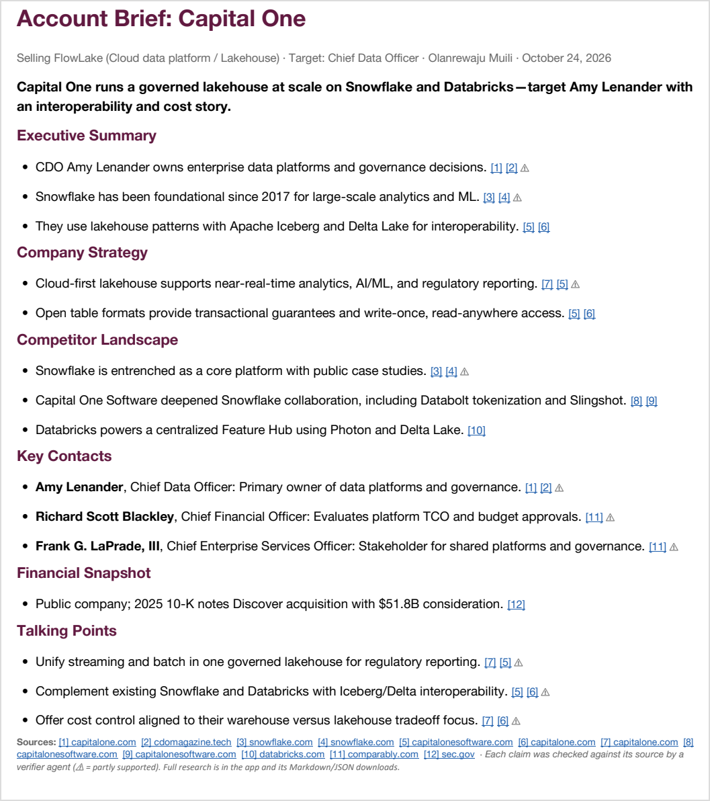
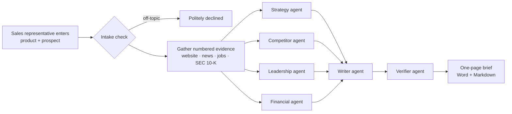

<h1 align="center">Sales Agent Prototype Using Multi-Agent GPT Models</h1>

<p align="center">
  <b>A sales assistant agent that helps a new sales representative gain insights into a prospective account, understand which competitors the account might be working with, and grasp the company's strategy in the area the representative is trying to sell.</b>
</p>

<p align="center">
  
  
  
  
  
</p>

<p align="center">
  
  <br>
  <sub>A real brief the app generated for Capital One. Each <code>[n]</code> links to the article, filing or page it came from.</sub>
</p>

---

## The problem

A new sales representative has a meeting with a big company tomorrow. To be ready, they need to know what the company is focused on, who makes the decisions, and whether it already buys from a competitor. Finding that out means hours of searching news, LinkedIn, job boards and annual reports.

AI chatbots can answer in seconds, but they **make things up**: invented executives, quotes nobody said, partnerships that don't exist. In sales, one wrong "fact" in front of a customer costs more than the time saved.

## What I built

I built a prototype sales assistant agent that does this research and writes the brief, **without making things up**. Behind it, several GPT-powered agents work together, each with one job. Building it meant working across the whole LLM stack: grounding models in real data, designing prompts and schemas, getting multiple agents to cooperate, checking their output, and measuring what actually worked.

| You enter | The app does | You get |
|---|---|---|
| Your product and what it's worth to customers | Reads the prospect's website and searches news, job postings and leadership pages | A one-page brief you can read in five minutes |
| The prospect's website | Pulls its latest annual report (10-K) from the SEC | Talking points tied to what the prospect actually said and did |
| Your competitors (optional) | Has specialist agents analyze it all, then fact-checks every sentence | A Word document with every claim linked to its source |

The brief covers what matters before a sales call:

- **Company strategy:** what the prospect is investing in, in your product's area
- **Competitor landscape:** whether they already use one of your competitors
- **Key contacts:** the people who own the budget, and why each one matters
- **Financial snapshot:** scale, priorities and recent deals, taken from SEC filings
- **Talking points:** conversation openers based on something the prospect did

## How it works



1. **Check the request.** Inputs are validated, and an intake step refuses anything that isn't sales research. It also works out the product category if the representative leaves it blank.
2. **Gather evidence before any AI writes anything.** The app collects 40–50 sources and numbers them `[1]`, `[2]`, … from:
   - the prospect's website;
   - targeted web and news searches;
   - job postings (what they hire for shows what they use);
   - the SEC's EDGAR database.
3. **Run specialist agents in parallel.** Four agents (strategy, competitors, leadership, financials) each read only the evidence their job needs. Every claim they make has to cite source numbers.
4. **Write the brief.** A writer agent picks what matters for *this* sale and condenses it to fit one printed page.
5. **Verify every claim.** A verifier agent checks each sentence against only the sources it cites. Unsupported claims are deleted, and partly supported ones are flagged ⚠ so the representative knows to double-check.

## Engineering highlights

These are the decisions that made the difference between a demo and a tool I'd trust.

- **Evidence first, AI second.** The model never answers from memory. It only works from numbered evidence, and every claim must cite it, so any fact in the brief can be traced back to a page.
- **A second agent fact-checks the first.** Across my test runs the verifier checked 43–47 claims per brief and removed up to 5 that the sources did not support.
- **Code before AI.** Plain Python does the cheap, deterministic work before any model call: validation, filtering irrelevant search results, finding which sources mention a competitor, and dropping citations to sources that don't exist. If no source mentions a competitor, the competitor agent skips the model call entirely.
- **Specialist agents in parallel.** Small, single-purpose prompts are easier to test and improve than one giant prompt. Running them concurrently keeps a full run to about 2.5 minutes.
- **A one-pager that actually fits on one page.** Counting words didn't work, because line wrapping, headings and citations all take space. Instead I estimate the printed height, tell the writer how much the draft overflows ("this draft is 18% too long"), and let it cut until the brief fits at a readable font size. I confirmed the result by rendering it in Microsoft Word.
- **Typed contracts between steps.** Every agent returns a Pydantic model. Invalid model output is caught, the validation error is sent back to the model, and it retries.
- **Guardrails.** Off-topic requests are refused before any money is spent. Web content is treated as untrusted data, so instructions hidden in a scraped page are ignored (prompt-injection defense).
- **Tested without the network.** 31 automated tests run in under 2 seconds with a fake model client. They cover:
  - the full pipeline;
  - the verifier;
  - parsing;
  - document output;
  - the web UI.
- **Built to survive the real web.** The app expects sites to block it, searches to come back empty and SEC documents to be messy:
  - retries with backoff;
  - search throttling;
  - a 24-hour cache;
  - when a source fails, the brief notes the gap and carries on.

## Results from real runs

| Prospect | Sources collected | Claims verified | Fully supported | Partly supported | Removed | Run time |
|---|---|---|---|---|---|---|
| Capital One | 41 | 47 | 24 | 22 | 1 | ~2.5 min |
| Target | 52 | 43 | 24 | 14 | 5 | ~2.5 min |

A sample one-pager on the Per Scholas template is in [`docs/samples/`](docs/samples/).

## Tech stack

| Area | Tools |
|---|---|
| Language | Python 3.13, managed with uv |
| Web app | Streamlit |
| Language models | OpenAI API: a fast model for the research agents, a stronger model for the writer and verifier |
| Data contracts | Pydantic |
| Web research | httpx, trafilatura, lxml, Tavily or DuckDuckGo search |
| Public filings | SEC EDGAR API |
| Documents | python-docx (Word), Markdown, PDF/PowerPoint/Word parsing for uploaded decks |
| Alerts | SQLite and SMTP |
| Testing | pytest, Streamlit AppTest |

## Getting started

```bash
git clone <this-repo>
cd cap-931
uv sync                      # install dependencies
cp .env.example .env         # then add your OPENAI_API_KEY
uv run cap-931               # opens the app at http://localhost:8501
```

Click **Fill in an example**, then **Generate account brief**.

| Setting | Required | Purpose |
|---|---|---|
| `OPENAI_API_KEY` | yes | Access to the language models |
| `TAVILY_API_KEY` | no | Richer search results (falls back to DuckDuckGo) |
| `OPENAI_FAST_MODEL` / `OPENAI_SMART_MODEL` | no | Choose the models for the research agents and the writer/verifier |
| `SMTP_USER` / `SMTP_PASSWORD` | no | Email delivery for keyword alerts |

## Features

- **Input validation:** a clear message for every problem, not just the first.
- **Optional product deck upload** (PDF, PowerPoint, Word) to give the agents more context.
- **Live progress** while the research runs.
- **Downloads:** the one-page brief as Word, the full research as Markdown, and the raw data as JSON.
- **Keyword alerts:** watch a company for news or job postings that match keywords, and get an email when something new appears. Runs on a schedule with `uv run cap-931-alerts`.

## Project structure

```
src/cap_931/
├── app.py           Streamlit web app
├── validation.py    input checks
├── pipeline.py      runs the whole flow: intake → evidence → agents → writer → verifier
├── agents.py        every agent's prompt and logic
├── llm.py           model calls with schema validation, retries and token tracking
├── schemas.py       typed data models shared by every step
├── layout.py        estimates the printed page so the brief fits on one page
├── render.py        Word and Markdown output
├── alerts.py        keyword alerts (SQLite + email)
└── research/
    ├── fetch.py     reads web pages and extracts clean text
    ├── search.py    web and news search with throttling and retries
    ├── edgar.py     SEC 10-K lookup and section extraction
    ├── gather.py    builds the numbered evidence pool
    └── deck.py      reads uploaded product decks
tests/               31 tests, no network or API key needed
docs/                technical design, deployment plan, samples
```

## Testing

```bash
uv run pytest
```

The tests swap the model client for a fake one, so they are fast, free and give the same result every time. They cover the agents, the verifier, input validation, web parsing, SEC extraction, document output, alerts and the Streamlit UI.

## Design docs

- [Technical design](docs/TECHNICAL.md): architecture, key decisions, model choice
- [Deployment plan](docs/DEPLOYMENT.md): scaling, security and operations for production

## What I'd build next

- **Run research jobs in a background queue,** so a 2-minute run doesn't tie up the web server.
- **Single sign-on, per-user quotas and a shared cache** for a sales team.
- **Generate a meeting slide deck** from the same structured research.
- **Let sales representatives add their own documents** (RFPs, call notes), so they're cited alongside public sources.

---

<p align="center">Built by <b>Olanrewaju Muili</b></p>
